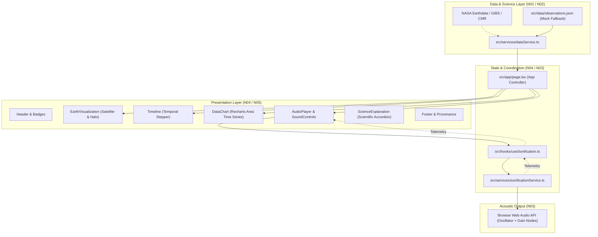

# BREATHE – System Architecture

This document describes the architectural foundation of **BREATHE**, detailing component boundaries, unidirectional data flow, audio integration, and ownership across the 6 hackathon workstreams.

---

## 1. High-Level Architectural Diagram



---

## 2. Directory Structure & Workstream Ownership

```text
BREATHE/
├── public/                     # N05: Static icons, visuals, audio samples
│   ├── images/
│   ├── icons/
│   └── audio/
│
├── docs/                       # Shared Documentation & Contracts
│   ├── PROJECT_OVERVIEW.md     # All Workstreams
│   ├── ARCHITECTURE.md         # N04 / N06
│   ├── DATA_CONTRACT.md        # N01 / N02
│   ├── SONIFICATION_CONTRACT.md# N02 / N03
│   ├── CONTRIBUTING.md         # N06
│   └── TEAM_TASKS.md           # N06 (Workstream Roadmap)
│
├── src/
│   ├── app/                    # N04: App Router Pages & Styles
│   │   ├── layout.tsx
│   │   ├── page.tsx            # Main Application Controller
│   │   ├── globals.css         # Tailwind & Global Styles
│   │   └── icon.svg            # Favicon Asset
│   │
│   ├── components/
│   │   ├── layout/             # N04 / N05: Global layout chrome
│   │   │   ├── Header.tsx
│   │   │   └── Footer.tsx
│   │   │
│   │   ├── visualization/      # N04 / N05: Visual panels & charts
│   │   │   ├── EarthVisualization.tsx
│   │   │   ├── Timeline.tsx
│   │   │   └── DataChart.tsx
│   │   │
│   │   ├── audio/              # N03 / N04: Sonification UI
│   │   │   ├── AudioPlayer.tsx
│   │   │   └── SoundControls.tsx
│   │   │
│   │   └── science/            # N02 / N05: Educational storytelling
│   │       └── ScienceExplanation.tsx
│   │
│   ├── hooks/                  # N03 / N04: React reactive hooks
│   │   └── useSonification.ts
│   │
│   ├── services/               # Modular service singletons
│   │   ├── dataService.ts      # Owned by N01 (Data Engineering)
│   │   └── sonificationService.ts # Owned by N03 (Sonification)
│   │
│   ├── types/                  # Shared Strict TypeScript Interfaces
│   │   ├── observation.ts      # N01 / N02 / N04
│   │   ├── dataset.ts          # N01 / N02 / N04
│   │   └── audio.ts            # N03 / N04
│   │
│   ├── data/                   # N01: Datasets (Mock & Ingested)
│   │   └── observations.json
│   │
│   └── lib/                    # Shared Utility Functions
│       └── utils.ts
│
├── package.json
├── tsconfig.json
├── tailwind.config.ts
└── README.md
```

---

## 3. Workstream Boundaries

| Workstream | Role | Primary Integration Targets | Strict Boundary Rule |
| :--- | :--- | :--- | :--- |
| **N01 – Data Engineering** | Ingest NASA data, normalize CSV/JSON, provenance | `src/data/`, `src/services/dataService.ts`, `docs/DATA_CONTRACT.md` | Must adhere to `Observation` and `Dataset` interfaces. |
| **N02 – Scientific Research** | Variable definition, validation, sonification curve | `src/types/`, `docs/DATA_CONTRACT.md`, `docs/SONIFICATION_CONTRACT.md` | Must validate that AOD is never portrayed as AQI. |
| **N03 – Sonification** | Web Audio synthesis, acoustic mapping, tone curves | `src/services/sonificationService.ts`, `src/hooks/useSonification.ts`, `src/types/audio.ts` | Must not duplicate UI components or run conflicting audio contexts. |
| **N04 – Frontend Development** | UI composition, layout, responsive interactivity | `src/app/`, `src/components/`, `src/hooks/` | Uses `dataService` and `useSonification` without altering service internals. |
| **N05 – UI/UX & Storytelling** | Visual hierarchy, color tokens, narrative assets | `public/`, `src/app/globals.css`, `tailwind.config.ts` | Coordinates theme changes without breaking layout markup. |
| **N06 – Integration & QA** | Verification, test scripts, docs, merge gate | `docs/TEAM_TASKS.md`, `docs/CONTRIBUTING.md`, `README.md` | Validates PR compatibility and cross-module contracts. |

---

## 4. Unidirectional Data Flow

1. **Initialization:** `src/app/page.tsx` calls `dataService.getDataset()` and `dataService.getObservations()`.
2. **Active State:** The controller manages `selectedObservation` (single active `Observation`).
3. **Synchronization:**
   - **Visualization (`EarthVisualization.tsx`):** Reads `selectedObservation.imageUrl`, value, unit, and coordinates.
   - **Timeline (`Timeline.tsx`):** Highlights `currentIndex` and steps left/right.
   - **Chart (`DataChart.tsx`):** Renders time-series data with an active reference line matching `selectedObservation.timestamp`.
   - **Audio Player (`AudioPlayer.tsx`):** Dispatches `SonificationInput` to `useSonification()`.
4. **Reactive Audio:** `sonificationService` adjusts frequency smoothly via `exponentialRampToValueAtTime()` without audio pops or re-allocating `AudioContext`.

---

## 5. Audio Integration Architecture

- **Lazy Initialization:** `AudioContext` is only instantiated after an explicit user gesture (Play button click), satisfying browser autoplay security.
- **Audio Graph Topology:**
  ```text
  [Primary Oscillator Node] ---> [Gain Node] ----\
                                                   +---> [Audio Destination (Speakers)]
  [Sub-Oscillator (Harmonic)] -> [Sub Gain Node] -/
  ```
- **Cleanup Guarantee:** On unmount or stop, scheduling is cancelled, nodes are disconnected, and oscillators stopped to prevent browser memory leaks.
