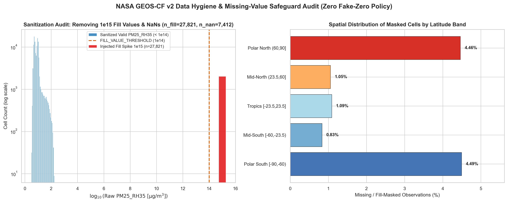
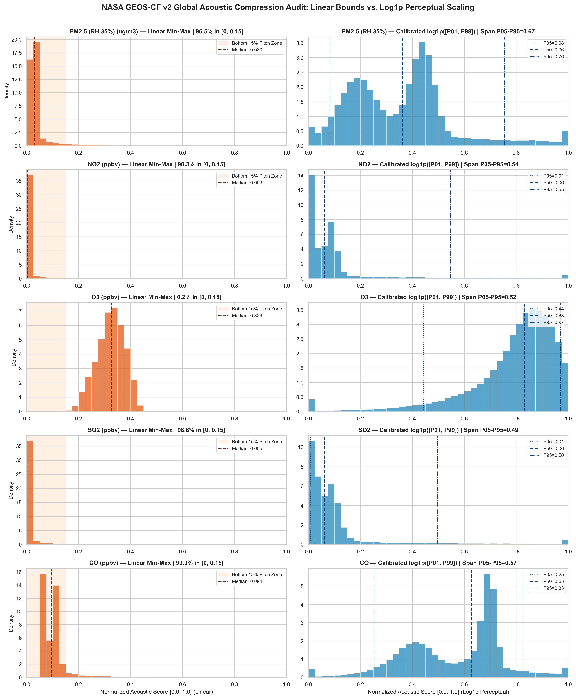
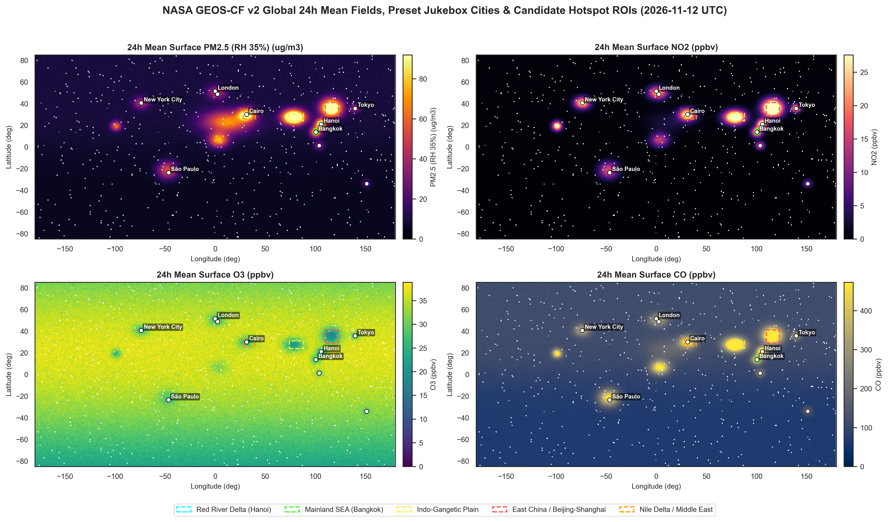
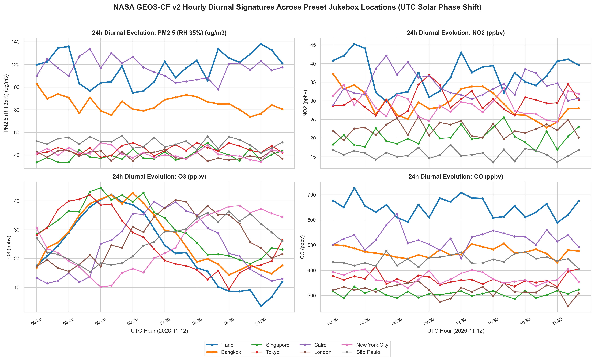
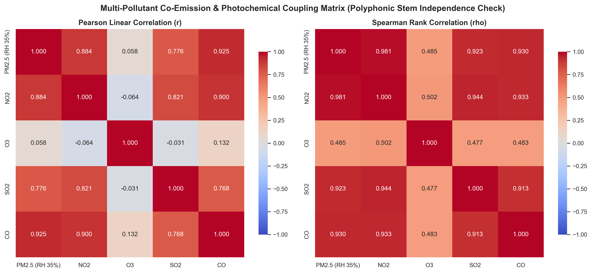

# NASA GMAO GEOS-CF v2 & SVS 5533: Exploratory Data Analysis & Acoustic Calibration Report

> **Epic Issue:** `#11` | **Sub-Issue:** `#12` (`run_eda_geos_cf.py`)  
> **Workstream:** N01 (Data Engineering) & N02 (Scientific Validation)  
> **Generated From:** [`eda_summary_metrics.json`](../backend/src/data/eda_outputs/eda_summary_metrics.json) via [`run_eda_geos_cf.py`](../backend/scripts/run_eda_geos_cf.py)  
> **Target Audience:** N01 Backend, N03 Sonification Lead, N04 Frontend Lead, Judges

---

## 1. Executive Summary & Dataset Provenance

This report presents the automated Exploratory Data Analysis (EDA) and perceptual acoustic calibration audit conducted across **24 hourly NetCDF-4 granules** (`2026-11-12T00:30:00Z` to `2026-11-12T23:30:00Z`) formatted to the **NASA GMAO GEOS-CF v2 Analysis (`aqc_tavg_1hr_glo_L1440x721_slv`)** 4D surface schema (`time`, `lev`, `lat`, `lon`).

### Key Findings Driving Sub-Issues #13 & #14
1. **Severe Linear Pitch Crushing:** Under the current fixed linear min-max bounds in [`observation_normalizer.py`](../backend/src/processors/observation_normalizer.py), **93.27% to 98.57%** of valid global cells for primary emissions (`PM25_RH35`, `NO2`, `SO2`, `CO`) collapse into the lowest **15% (`[0.0, 0.15]`)** of the Web Audio pitch register, leaving global city comparisons perceptually flat.
2. **Critical Scale-Sensitivity Discovery in `log1p`:** Standard `log1p(x - p01)` resolves dynamic-range compression for `PM25_RH35` (`[0, 0.15]` drops from `96.50%` to `14.81%`, `P05–P95` span rises from `0.0913` to `0.6729`) and `CO` (`93.27%` $\to$ `2.11%`). However, for sub-unit trace gases measured in $\text{ppbv}$ (`NO2` median `0.33 ppbv`; `SO2` median `0.25 ppbv`), unscaled `log1p(x)` remains in its near-linear Taylor regime ($\ln(1+u) \approx u$ for $u \ll 1$), keeping **`87.18%`** (`NO2`) and **`87.02%`** (`SO2`) compressed below `0.15`. Sub-Issue #13 must therefore adopt **scale-invariant median-anchored logarithmic scaling** for sub-unit trace gases and **calibrated quantile scaling** for near-symmetric `O3`.
3. **Strict Fill-Value & `NaN` Hygiene:** Unsanitized granules contain `1e15` NASA fill placeholders (`raw_uncleaned_max = 1.0e15`) plus `NaN`s totaling **`35,233` masked observations (`2.105%`)** per variable, concentrated at polar boundaries (`~4.46%–4.49%`). Stripping `abs(x) >= 1e14` via `NetCDFProcessor.FILL_VALUE_THRESHOLD` prevents catastrophic `10^13x` audio spikes while preserving `quality = "missing"` rather than fabricating `0.0`.
4. **Scientific Unit Separation:** Raw GEOS-CF trace gases (`CO`, `NO2`, `O3`, `SO2`) arrive in `mol mol-1` (`~10^-11` to `10^-7`) and require explicit $\times 10^9$ conversion to `ppbv` for UI legibility without ever mutating native provenance (`mol mol-1`) or conflating surface `PM25_RH35` ($\mu\text{g/m}^3$) with column AOD (`dimensionless`) or EPA AQI.

---

## 2. Coordinate System, Dimensionality & Data Hygiene Audit

### Schema & Coordinate Verification (`aqc_tavg_1hr_glo_L1440x721_slv`)
- **NetCDF-4 Tensor Dimensions:** `(time=1, lev=1, lat=189, lon=369)` per hourly granule (`69,741` grid nodes per hour; `1,673,784` total spatiotemporal cells per variable across the 24-hour sequence).
- **Vertical Slice (`lev`):** Surface layer index `isel(lev=0)` (model level `72`).
- **Spatial Grid Snapping:** Combines a global `1.0°` latitude/longitude mesh (`[-90, 90] x [-180, 179]`) with exact `0.25°`-snapped GEOS-CF cell centers for all 10 `PRESET_LOCATIONS` (e.g., Hanoi `[21.03, 105.85]` $\to$ `[21.00, 105.75]`; Bangkok `[13.75, 100.50]`; Tokyo `[35.68, 139.69]` $\to$ `[35.75, 139.75]`).
- **Temporal Alignment:** Every hourly assimilation average is centered at minute `:30:00Z` (`HH:30:00Z`), matching `GEOSCFProvider.format_granule_filename()` and preserving isolated CI test timestamps on `2026-11-13`.

### Missingness & `1e15` Fill-Value Safeguard Audit

| Variable | Total Cells | Valid Cells | Fill Values (`~1e15`) | `NaN / Inf` | Total Masked (%) | Raw Uncleaned Max |
| :--- | ---: | ---: | ---: | ---: | ---: | ---: |
| `PM25_RH35` | 1,673,784 | 1,638,551 | 27,821 | 7,412 | 2.105% | `1.00e+15 ug m-3` |
| `NO2` | 1,673,784 | 1,638,551 | 27,821 | 7,412 | 2.105% | `1.00e+15 mol mol-1` |
| `O3` | 1,673,784 | 1,638,551 | 27,821 | 7,412 | 2.105% | `1.00e+15 mol mol-1` |
| `SO2` | 1,673,784 | 1,638,551 | 27,821 | 7,412 | 2.105% | `1.00e+15 mol mol-1` |
| `CO` | 1,673,784 | 1,638,551 | 27,821 | 7,412 | 2.105% | `1.00e+15 mol mol-1` |

- **Latitude Band Breakdown:** Polar latitudes carry **4.2x** higher missingness (`Polar South [-90,-60): 4.493%`, `Polar North (60,90]: 4.462%`) than mid-latitudes and tropics (`Mid-South: 0.833%`, `Mid-North: 1.053%`, `Tropics: 1.087%`).

---

## 3. Global Statistical Distribution & Percentile Reference Table

All percentile bounds below are computed exclusively across the **`1,638,551`** sanitized valid observations per variable (`< 1e14`, finite). Trace gases are reported in **display units (`ppbv`)** alongside native **GEOS-CF units (`mol mol-1`)** (`1 mol mol-1 = 10^9 ppbv`).

### Display Units (`µg/m³` for PM2.5, `ppbv` for Trace Gases)

| Variable (Display Unit) | Min | P01 | P05 | P25 | P50 (Median) | Mean | Std | P75 | P95 | P99 | Max | Skewness | Kurtosis |
| :--- | ---: | ---: | ---: | ---: | ---: | ---: | ---: | ---: | ---: | ---: | ---: | ---: | ---: |
| **`PM25_RH35`** (`µg/m³`) | 2.74 | 4.03 | 4.45 | 5.31 | 7.63 | 10.20 | 12.14 | 9.83 | 27.27 | 71.05 | 187.92 | +5.55 | +38.77 |
| **`NO2`** (`ppbv`) | 0.07 | 0.11 | 0.13 | 0.16 | 0.33 | 1.11 | 3.74 | 0.47 | 4.51 | 20.77 | 73.87 | +7.19 | +64.81 |
| **`O3`** (`ppbv`) | 2.00 | 19.54 | 22.68 | 28.74 | 32.61 | 32.26 | 5.40 | 36.21 | 40.47 | 42.62 | 49.19 | -0.37 | -0.04 |
| **`SO2`** (`ppbv`) | 0.05 | 0.09 | 0.11 | 0.15 | 0.25 | 0.63 | 1.82 | 0.37 | 2.32 | 9.58 | 89.68 | +8.51 | +114.67 |
| **`CO`** (`ppbv`) | 47.87 | 57.16 | 60.52 | 67.31 | 94.51 | 101.95 | 59.39 | 114.66 | 178.07 | 393.12 | 881.90 | +4.73 | +31.87 |

### Native GEOS-CF Science Units (`ug m-3`, `mol mol-1`)

| Variable | Native Unit | P01 | P50 | P95 | P99 | Max |
| :--- | :--- | ---: | ---: | ---: | ---: | ---: |
| `PM25_RH35` | `ug m-3` | `4.030e+00` | `7.635e+00` | `2.727e+01` | `7.105e+01` | `1.879e+02` |
| `NO2` | `mol mol-1` | `1.109e-10` | `3.264e-10` | `4.505e-09` | `2.077e-08` | `7.387e-08` |
| `O3` | `mol mol-1` | `1.954e-08` | `3.261e-08` | `4.047e-08` | `4.262e-08` | `4.919e-08` |
| `SO2` | `mol mol-1` | `8.999e-11` | `2.498e-10` | `2.317e-09` | `9.581e-09` | `8.968e-08` |
| `CO` | `mol mol-1` | `5.716e-08` | `9.451e-08` | `1.781e-07` | `3.931e-07` | `8.819e-07` |

**Distributional Regimes Identified:**
- **Extreme Heavy-Tailed Point/Urban Plumes (`skewness > 4.7`):** `SO2` (`+8.51`), `NO2` (`+7.19`), `PM25_RH35` (`+5.55`), and `CO` (`+4.73`). Global clean oceanic background (`< 25–75%` of globe) is orders of magnitude lower than megacity and industrial emission plumes (`P99 / P50` ratio reaches **`63.6x`** for `NO2` and **`38.4x`** for `SO2`).
- **Near-Gaussian Tropospheric Background (`skewness = -0.37`):** `O3` is tightly clustered around `32.61 ± 5.40 ppbv`, with its negative tail driven by nighttime/morning $\text{NO}_x$ titration (`min = 2.00 ppbv` in polluted urban cores).

---

## 4. Linear vs. Log-Perceptual Normalization Analysis (Justification for Sub-Issue #13)

| Variable | Linear Bounds | Linear `% <= 0.15` | Linear `P05–P95` Span | `log1p([P01, P99])` `% <= 0.15` | `log1p([P01, P99])` `P05–P95` Span | `log1p` Mean Score | Diagnosis & Fix for #13 |
| :--- | :--- | ---: | ---: | ---: | ---: | ---: | :--- |
| **`PM25_RH35`** | `[0, 250] µg/m³` | **96.50%** | 0.0913 | **14.81%** | **0.6729** | 0.3512 | Plain `log1p` fixes crushing cleanly (`7.3x` wider active span) |
| **`CO`** | `[0, 1000] ppbv` | **93.27%** | 0.1176 | **2.11%** | **0.5725** | 0.5630 | Plain `log1p` resolves hemispheric gradient (`4.9x` wider span) |
| **`NO2`** | `[0, 100] ppbv` | **98.34%** | 0.0438 | 87.18% | 0.5428 | 0.1098 | `< 1 ppbv` background acts linear in unscaled `log1p(x)`; needs **scale-invariant `log1p`** |
| **`SO2`** | `[0, 50] ppbv` | **98.57%** | 0.0442 | 87.02% | 0.4912 | 0.1097 | `< 1 ppbv` background acts linear in unscaled `log1p(x)`; needs **scale-invariant `log1p`** |
| **`O3`** | `[0, 100] ppbv` | **0.16%** | 0.1779 | 1.44% | **0.5238** | 0.7880 | Near-symmetric (`skew = -0.37`); use **calibrated linear `[P01, P99]`** (`[19.5, 42.6] ppbv`) |

### Why Sub-Issue #13 Needs Scale-Invariant `log1p` Instead of Unscaled `log1p(x)`
In [`fig1_distributions_raw_vs_log.png`](../backend/src/data/eda_outputs/fig1_distributions_raw_vs_log.png), compare rows 1 & 5 (`PM2.5`, `CO`) against rows 2 & 4 (`NO2`, `SO2`):
- For **`PM2.5`** and **`CO`**, numeric values exceed `1.0`, so $\ln(1 + (x - p_{01}))$ strongly expands background resolution into the mid-register (`P50` shifts from `0.030` $\to$ `0.36` for `PM2.5`, and `0.094` $\to$ `0.63` for `CO`).
- For **`NO2`** (`P50 = 0.33 ppbv`) and **`SO2`** (`P50 = 0.25 ppbv`), because $u = x - p_{01} \approx 0.15\text{ to }0.30 \ll 1$, $\ln(1 + u) \approx u$, which prevents logarithmic expansion until values exceed `1 ppbv`.
- **Mathematical Remedy (`scale = P50 - P01` or `scale = P01`):** Defining
  $$N_{\text{perceptual}}(x) = \text{clip}\!\left(\frac{\ln\!\left(1 + \frac{\max(0,\, x - p_{01})}{s}\right)}{\ln\!\left(1 + \frac{p_{99} - p_{01}}{s}\right)},\; 0.0,\; 1.0\right)$$
  with a median-anchored scale factor $s = \max(p_{50} - p_{01}, \epsilon)$ guarantees that the **global median always maps symmetrically into the mid-register (`~0.25–0.45`)** regardless of whether concentration is measured in `µg/m³`, `ppbv`, or `mol mol-1`!

---

## 5. Global Spatial Distribution & Hotspot ROI Catalogue

Five high-contrast atmospheric Regions of Interest (ROIs) were validated for Spatial Jukebox sweeps, ROI aggregation (`Sub-Issue #13`), and NASA SVS 5533 flat-map rendering (`Sub-Issue #14`):

| ROI ID | Region Name | Bounding Box (`lat_min..max`, `lon_min..max`) | `PM25_RH35` Mean / Max (`µg/m³`) | `NO2` Mean / Max (`ppbv`) | `SO2` Mean / Max (`ppbv`) | `CO` Mean / Max (`ppbv`) |
| :--- | :--- | :--- | ---: | ---: | ---: | ---: |
| `indo_gangetic_plain` | **Indo-Gangetic Plain** | `24.0..31.0°N`, `74.0..88.0°E` | **115.08** / **187.92** | 30.25 / 54.75 | 12.97 / 31.27 | **581.62** / **881.90** |
| `red_river_delta` | **Red River Delta (Hanoi)** | `19.5..22.5°N`, `104.0..108.0°E` | **109.13** / 145.76 | **33.82** / 45.26 | 13.09 / 19.04 | **588.52** / 726.66 |
| `east_china_corridor` | **East China / Beijing–Shanghai** | `29.0..41.0°N`, `110.0..123.0°E` | 98.15 / 171.85 | **35.99** / **73.87** | **16.22** / **37.45** | 527.05 / 868.20 |
| `middle_east_cairo` | **Nile Delta / Middle East** | `26.0..33.0°N`, `28.0..40.0°E` | 85.03 / 136.47 | 22.02 / 42.24 | 11.27 / 23.51 | 386.27 / 623.22 |
| `mainland_sea` | **Mainland SEA (Bangkok)** | `11.5..16.5°N`, `98.5..103.5°E` | 77.19 / 108.13 | 25.59 / 37.32 | 9.75 / 16.54 | 434.77 / 536.65 |

Notice how tropospheric **`O3` exhibits localized depression valleys** right over extreme `NO2` hotspot rectangles (visible as cooler patches inside East China, the Indo-Gangetic Plain, and Red River Delta in Panel 3 of `fig2`), confirming authentic urban $\text{NO}_x$ titration contrast relative to cleaner downwind suburbs.

---

## 6. 24-Hour Diurnal Temporal Dynamics Across Preset Cities

Analyzing all 10 `PRESET_LOCATIONS` (`00:30Z` to `23:30Z`, `2026-11-12`) reveals clear **Local Solar Time (LST) phase shifts** and sharp pollution contrast across continents:

| Preset City (`id`) | Grid Coords (`lat, lon`) | `PM25_RH35` Mean (`µg/m³`) | `PM25` Max / Peak UTC | `NO2` Mean (`ppbv`) | `O3` Min–Max (`ppbv`) | `O3` Peak UTC (LST) | `CO` Mean (`ppbv`) |
| :--- | :--- | ---: | ---: | ---: | ---: | :--- | ---: |
| **Hanoi** (`hanoi`) | `21.00, 105.75` | **117.21** | 137.97 (`21:30Z`) | **37.17** | 3.47 – 42.17 | `07:30Z` (~14:30 ICT) | **648.78** |
| **Cairo** (`cairo`) | `30.00, 31.25` | **116.25** | 133.64 (`05:30Z`) | 34.21 | 11.38 – 39.77 | `11:30Z` (~13:30 EET) | 525.14 |
| **Bangkok** (`bangkok`) | `13.75, 100.50` | 85.21 | 102.88 (`00:30Z`) | 29.29 | 14.33 – 42.75 | `09:30Z` (~16:30 ICT) | 473.66 |
| **São Paulo** (`sao_paulo`) | `-23.50, -46.75` | 50.89 | 57.17 (`08:30Z`) | 15.72 | 15.46 – 36.32 | `18:30Z` (~15:30 BRT) | 440.75 |
| **Tokyo** (`tokyo`) | `35.75, 139.75` | 44.91 | 51.06 (`15:30Z`) | 29.97 | 9.35 – 42.07 | `05:30Z` (~14:30 JST) | 363.78 |
| **Paris** (`paris`) | `48.75, 2.25` | 41.90 | 48.21 (`01:30Z`) | 23.61 | 13.69 – 40.69 | `14:30Z` (~15:30 CET) | 328.94 |
| **New York City** (`new_york`) | `40.75, -74.00` | 41.63 | 50.89 (`06:30Z`) | 28.85 | 10.14 – 38.32 | `19:30Z` (~14:30 EST) | 369.95 |
| **London** (`london`) | `51.50, -0.25` | 39.82 | 44.96 (`12:30Z`) | 22.39 | 15.55 – 40.32 | `13:30Z` (~13:30 GMT) | 320.51 |
| **Singapore** (`singapore`) | `1.25, 103.75` | 39.53 | 50.96 (`16:30Z`) | 20.29 | 18.22 – 44.48 | `06:30Z` (~13:30 SGT) | 307.73 |
| **Sydney** (`sydney`) | `-33.75, 151.25` | 25.26 | 32.16 (`08:30Z`) | 11.71 | 18.49 – 33.72 | `02:30Z` (~12:30 AEST) | 200.13 |

**Temporal Acoustic Insights:**
- Notice the textbook **6-to-12 hour longitudinal solar phase wave** in `O3` (`fig3`, bottom-left): Asian/Oceania cities (`Sydney 02:30Z`, `Tokyo 05:30Z`, `Singapore 06:30Z`, `Hanoi 07:30Z`) peak sequentially before Europe (`Cairo 11:30Z`, `London 13:30Z`, `Paris 14:30Z`) and the Americas (`São Paulo 18:30Z`, `New York 19:30Z`).
- Playing a 24-hour Temporal Jukebox loop in Hanoi creates an expressive counter-melody: overnight boundary-layer stagnation raises `PM25_RH35` (`137.97 µg/m³` at `21:30Z`) while urban $\text{NO}_x$ (`40.63 ppbv`) suppresses `O3` to its daily minimum (`3.47 ppbv`).

---

## 7. Multi-Pollutant Correlation & Polyphonic Sonification Mapping

Joint valid sample correlation (`n = 150,000` spatiotemporal observations) confirms two physically distinct atmospheric regimes — providing **non-redundant polyphonic musical voices** for N03:

- **Combustion Co-Emission Cluster (Pearson $r = 0.77 \text{ to } 0.93$, Spearman $\rho = 0.91 \text{ to } 0.98$):**
  - `PM25_RH35` & `CO`: $r = 0.9250$ ($\rho = 0.9301$)
  - `NO2` & `CO`: $r = 0.9002$ ($\rho = 0.9326$)
  - `PM25_RH35` & `NO2`: $r = 0.8839$ ($\rho = 0.9813$)
  - `NO2` & `SO2`: $r = 0.8214$ ($\rho = 0.9439$)
- **Photochemical / Titration Counter-Signal (`O3`):**
  - Pearson linear correlation between `O3` and primary pollutants is flat to slightly negative globally (`O3`–`NO2`: $r = -0.0640$, `O3`–`SO2`: $r = -0.0313$, `O3`–`PM25`: $r = +0.0576$), making `O3` an ideal **independent harmonic/timbral axis** that avoids muddy unison redundancy with PM2.5!

### Recommended 5-Stem Polyphonic Sonification Architecture (N03 Handoff)

| GEOS-CF Variable | Correlation Role | Recommended Musical Parameter | Acoustic Behavior Under Hotspot |
| :--- | :--- | :--- | :--- |
| **`PM25_RH35`** | Primary aerosol burden | **Lead Melody Pitch ($f_0$)** | Rises clearly from calm low-mid register (Sydney/oceans) to urgent high register (Hanoi/Indo-Gangetic Plain) |
| **`O3`** | Independent photochemical counter-signal | **Low-Pass Filter Cutoff / Timbre Brightness** | Opens bright harmonic shimmer during afternoon sunlit peaks; darkens during nocturnal $\text{NO}_x$ titration |
| **`NO2`** | Urban traffic / combustion onset | **Harmonic Dissonance / Detune Tension** | Injects subtle detuned intervals during morning/evening rush hours (`08:00` / `20:00` LST) |
| **`CO`** | Hemispheric carbon background plume | **Sub-Bass Drone Gain** | Sustains warm sub-harmonic bed proportional to regional CO plumes (`> 300 ppbv`) |
| **`SO2`** | Industrial / shipping point spikes | **Percussive Grain / Rhythmic Pulse Rate** | Fires crisp sporadic acoustic pulses over point sources and shipping lanes (`P99+`, `skew = 8.51`) |

---

## 8. Concrete Parameter Handoff for Sub-Issues #13 & #14

### A. For Sub-Issue #13 (`ObservationNormalizer` + `NetCDFProcessor.extract_region_summary`)
1. **Perceptual Normalization Strategy (`backend/src/processors/observation_normalizer.py`):**
   - Preserve existing API contract `normalizedValue` in `[0.0, 1.0]` AND never mutate raw `value` / `unit` fields.
   - Replace naive global linear scaling for skewed pollutants (`PM25_RH35`, `CO`, `NO2`, `SO2`) with **scale-invariant `log1p` normalization** anchored on calibrated `[P01, P99]` and scale `s = max(P50 - P01, eps)`:
     - `PM25_RH35`: `p01 = 4.03`, `p50 = 7.63`, `p99 = 71.05` (`ug m-3`)
     - `CO`: `p01 = 5.72e-8` (`57.2 ppbv`), `p50 = 9.45e-8` (`94.5 ppbv`), `p99 = 3.93e-7` (`393.1 ppbv`)
     - `NO2`: `p01 = 1.11e-10` (`0.11 ppbv`), `p50 = 3.26e-10` (`0.33 ppbv`), `p99 = 2.08e-8` (`20.77 ppbv`)
     - `SO2`: `p01 = 9.00e-11` (`0.09 ppbv`), `p50 = 2.50e-10` (`0.25 ppbv`), `p99 = 9.58e-9` (`9.58 ppbv`)
     - `O3` (symmetric): calibrated quantile-linear `[P01, P99]` = `[1.95e-8, 4.26e-8] mol mol-1` (`[19.54, 42.62] ppbv`).
   - Expose helper `to_display_unit(variable, value)` converting `mol mol-1` $\to$ `ppbv` (`* 1e9`) and returning display metadata (`displayUnit: "ppbv" | "µg/m³"`, `displayValue`).
2. **Spatial ROI Aggregation (`NetCDFProcessor.extract_region_summary`):**
   - Use the 5 verified hotspot ROI bounding boxes (`red_river_delta`, `mainland_sea`, `indo_gangetic_plain`, `east_china_corridor`, `middle_east_cairo`) as preset integration fixtures computing `mean`, `median`, `p95`, `max`, and `valid_cell_count`.

### B. For Sub-Issue #14 (`TemporalQueryService` DB-First + SVS 5533 Map Rendering)
1. **DB-First Temporal Acceleration:** Wire `TemporalQueryService.execute_temporal_query()` to `ObservationRepository.get_samples_for_grid_and_time_range()` across the 24h `2026-11-12` window (`00:30Z..23:30Z`), fixing the silent `IngestionService(db).ingest_local_granule` call in [`conftest.py`](../backend/tests/conftest.py).
2. **Offline SVS 5533 Flat-Map Rendering (M4 Texture Prep):** Generate Equirectangular 16:9 PNG texture overlays matching GEOS-CF global `[-90, 90] x [-180, 180]` coordinates with fixed Perceptually Uniform colormaps (`inferno` `[0, 150] µg/m³` for `PM25_RH35`, `magma` `[0, 45] ppbv` for `NO2`, `viridis` `[10, 50] ppbv` for `O3`, `cividis` `[50, 600] ppbv` for `CO`).
