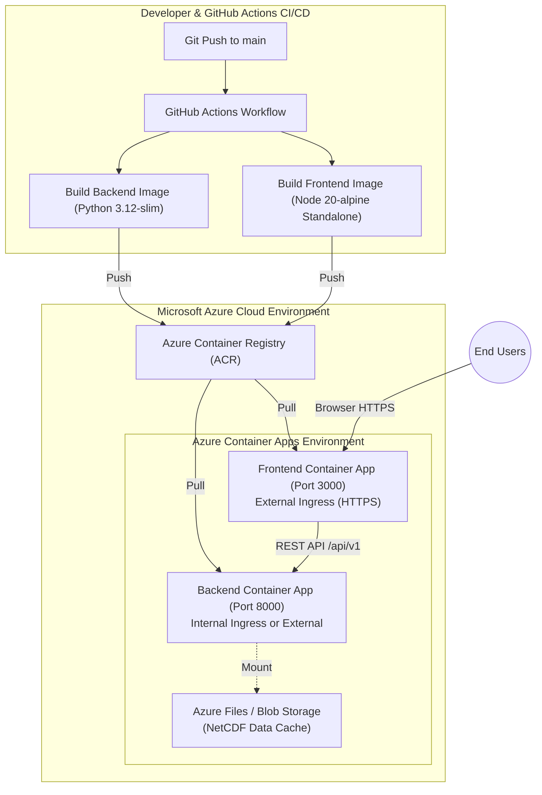

# Kế hoạch Triển khai Docker & Azure cho BREATHE Earth Jukebox

> **For agentic workers:** REQUIRED SUB-SKILL: Use `superpowers:subagent-driven-development` or `superpowers:executing-plans` to implement this plan task-by-task. Steps use checkbox (`- [ ]`) syntax for tracking.

**Goal:** Đóng gói toàn bộ hệ thống BREATHE Earth Jukebox (FastAPI Backend + Next.js 14 Frontend) vào các Docker container chuẩn hóa, tối ưu kích thước, bảo mật không chạy quyền root, và thiết lập luồng triển khai tự động hóa lên hạ tầng đám mây Microsoft Azure (Azure Container Apps & ACR).

**Architecture:** Kiến trúc Microservices phân tách:
1. **Frontend Container:** Next.js 14 chạy Node.js 20 Alpine với `output: 'standalone'`, MapLibre GL worker tự động đồng bộ.
2. **Backend Container:** FastAPI chạy Python 3.12-slim với đầy đủ C-libraries phục vụ xử lý raster NetCDF4/HDF5/xarray, hỗ trợ cấu hình DB kép (PostgreSQL production / SQLite fallback) và volume lưu trữ NetCDF.
3. **Azure Target:** Azure Container Apps (ACA) kết hợp Azure Container Registry (ACR), ingress HTTPS tích hợp, autoscaling từ 0 để tiết kiệm chi phí, và GitHub Actions CI/CD pipeline tự động build/push/deploy.

**Tech Stack:** Docker, Docker Compose, Next.js 14 (React 18, TypeScript), FastAPI (Python 3.12, NetCDF4, xarray, Uvicorn), PostgreSQL 16 / SQLite, Azure Container Apps (ACA), Azure Container Registry (ACR), GitHub Actions.

---

## Skills & Subagents Mapping

Theo giao thức `Agents-kit` và định nghĩa tại `agents.toml`:

| Phase / Nhiệm vụ | Local Skills / Tools | Phụ trách Subagent (`agents.toml`) |
| :--- | :--- | :--- |
| **Phase 1: Backend Dockerization** | `python-project-structure`, `pydantic-v2` | `python_backend` |
| **Phase 2: Frontend Standalone Dockerization** | `modern-web-guidance`, Next.js standalone build | `frontend_developer` |
| **Phase 3: Docker Compose & Local Orchestration** | Docker compose, networking, healthcheck | `frontend_architect` |
| **Phase 4: Azure IaC & Deployment Scripts** | Azure CLI / Bicep / ACR / ACA | `backend_architect` / `security_auditor` |
| **Phase 5: GitHub Actions CI/CD Pipeline** | GitHub Actions workflow, secret management | `security_auditor` |
| **Phase 6: QA, Smoke Test & Verification** | `verification-before-completion` | `qa_reviewer` |

---

## Global Constraints

1. **Non-Root Security:** Cả hai container Backend và Frontend tuyệt đối không chạy bằng user `root` trong môi trường sản xuất (`UID 10001` hoặc `node`/`appuser`).
2. **Minimal Image Size:** 
   - Frontend áp dụng Next.js `output: 'standalone'` trên nền `node:20-alpine` (mục tiêu image < 180MB).
   - Backend sử dụng multi-stage hoặc `python:3.12-slim` đã dọn sạch cache apt và wheel (mục tiêu image < 400MB dù có C-libraries).
3. **State & Volume Isolation:** Dữ liệu NetCDF (`src/data/raw`) và database SQLite (`src/data/breathe.db`) phải tách biệt trên volume riêng biệt để container là stateless.
4. **Environment Configuration:** Không hardcode secret hoặc credentials; mọi thông số (CORS, URLs, Ports, Tokens) truyền qua Docker Environment Variables.

---

## Review Focus (Những điểm cốt lõi cần lưu ý)

1. **MapLibre Web Worker trong Docker:** Frontend cần file `public/maplibre-gl-worker.mjs`. Quá trình build Docker phải đảm bảo script `scripts/sync-maplibre-worker.mjs` được chạy trước `next build`.
2. **Scientific C-Libraries:** `netCDF4`, `h5py`, `scipy` yêu cầu thư viện hệ thống C (`libnetcdf-dev`, `libhdf5-dev`). Phải cài đặt đúng dependency trong Debian slim mà không làm phình image.
3. **Next.js Client-Side Environment Variables:** Các biến bắt đầu bằng `NEXT_PUBLIC_*` (như `NEXT_PUBLIC_BACKEND_URL`) được Next.js nhúng vào bundle lúc build time. Cần cơ chế build-arg linh hoạt hoặc reverse proxy.
4. **Azure Container Apps Scale-to-Zero:** Khi backend scale về 0, request đầu tiên có thể mất vài giây. Health probe cần cấu hình hợp lý (`startupProbe`, `livenessProbe`).
5. **CORS trên Azure:** CORS_ORIGINS của FastAPI backend phải chấp nhận FQDN của Azure Container App Frontend.

---

## Chi tiết các Task triển khai

### Task 1: Thiết lập Dockerfile & `.dockerignore` cho Backend FastAPI

**Files:**
- Create: `backend/Dockerfile`
- Create: `backend/.dockerignore`
- Create: `backend/docker-entrypoint.sh`

- [ ] **Step 1.1:** Tạo `backend/.dockerignore` loại bỏ `.venv`, `__pycache__`, `.pytest_cache`, `.git`, `tests`, `*.db`, `data/raw/*`.
- [ ] **Step 1.2:** Tạo `backend/Dockerfile` đa tầng:
  - Base: `python:3.12-slim-bookworm`.
  - Cài đặt runtime packages: `libnetcdf-dev`, `libhdf5-dev`, `curl` (để container healthcheck).
  - Cài đặt Python dependencies qua `requirements.txt` bằng `pip` (hoặc `uv` để tăng tốc độ build).
  - Tạo non-root user `breathe:breathe` (UID 1001).
  - Phân quyền thư mục `data/` cho user `breathe`.
  - Expose port `8000`.
  - Healthcheck: `curl -f http://localhost:8000/api/v1/health || exit 1`.
- [ ] **Step 1.3:** Tạo `backend/docker-entrypoint.sh`:
  - Thực hiện chạy migration nếu cấu hình: `alembic upgrade head || true`.
  - Khởi động server: `exec uvicorn src.main:app --host 0.0.0.0 --port ${PORT:-8000} --workers 2`.
- [ ] **Step 1.4:** Test build image backend cục bộ: `docker build -t breathe-backend:test ./backend` và kiểm tra `docker run` thành công.

---

### Task 2: Thiết lập Dockerfile & `.dockerignore` cho Frontend Next.js

**Files:**
- Modify: `frontend/next.config.mjs` (bổ sung `output: 'standalone'`)
- Create: `frontend/Dockerfile`
- Create: `frontend/.dockerignore`

- [ ] **Step 2.1:** Cập nhật `frontend/next.config.mjs` thêm `output: "standalone"` để Next.js chỉ trích xuất các module cần thiết khi chạy production.
- [ ] **Step 2.2:** Tạo `frontend/.dockerignore` loại bỏ `node_modules`, `.next`, `.git`, `.env*.local`.
- [ ] **Step 2.3:** Tạo `frontend/Dockerfile` với 3 giai đoạn (Multi-stage build):
  - **Stage 1: deps** (`node:20-alpine`): Copy `package.json`, `package-lock.json`, chạy `npm ci`.
  - **Stage 2: builder** (`node:20-alpine`): Copy mã nguồn và `node_modules`, chạy `node scripts/sync-maplibre-worker.mjs`, nhận ARG `NEXT_PUBLIC_BACKEND_URL`, chạy `npm run build`.
  - **Stage 3: runner** (`node:20-alpine`):
    - Tạo user `nextjs:nodejs` (UID 1001).
    - Copy `.next/standalone`, `.next/static` vào `.next/static`, copy `public/`.
    - Expose port `3000`.
    - Healthcheck: `wget --no-verbose --tries=1 --spider http://localhost:3000/api/health || exit 1` (hoặc check HTTP `/`).
    - CMD: `node server.js`.
- [ ] **Step 2.4:** Test build image frontend cục bộ: `docker build -t breathe-frontend:test ./frontend`.

---

### Task 3: Cấu hình Local & Staging Orchestration (`docker-compose.yml`)

**Files:**
- Create: `docker-compose.yml`
- Create: `.env.docker`

- [ ] **Step 3.1:** Tạo file `docker-compose.yml` tại thư mục gốc của repository:
  - Service `backend`:
    - Build context `./backend`.
    - Port: `8000:8000`.
    - Volume: `breathe-data:/app/src/data`.
    - Environment: nạp từ `.env.docker` hoặc file env.
  - Service `frontend`:
    - Build context `./frontend`.
    - Port: `3000:3000`.
    - Depends on: `backend` (condition: service_healthy).
  - Service `postgres` (Tùy chọn cho profile full database):
    - Image: `postgres:16-alpine`.
    - Volume: `postgres-data:/var/lib/postgresql/data`.
- [ ] **Step 3.2:** Khởi chạy thử nghiệm `docker compose up -d` và kiểm tra tính liên kết giữa Frontend và Backend.

---

### Task 4: Kiến trúc Triển khai trên Microsoft Azure

**Target được khuyến nghị:** **Azure Container Apps (ACA)** kết hợp **Azure Container Registry (ACR)**.

**Files:**
- Create: `docs/deploy/azure-deployment-guide.md`
- Create: `scripts/deploy-azure.sh` (Azure CLI automate script)

- [ ] **Step 4.1:** Chuẩn bị tài nguyên Azure:
  - Resource Group: `rg-breathe-prod` (Region: `eastus` hoặc `southeastasia`).
  - Azure Container Registry: `acrbreatheprod` (SKU Basic).
  - Azure Container Apps Environment: `cae-breathe-prod` (Log Analytics tích hợp).
  - Azure Storage Account & File Share (nếu cần mount persistent volume cho file NetCDF cache).
- [ ] **Step 4.2:** Viết kịch bản tự động hóa Azure CLI (`scripts/deploy-azure.sh`):
  - Khởi tạo ACR, build và push images.
  - Tạo Container Apps cho backend (port 8000) và frontend (port 3000).
  - Thiết lập ingress, scaling rules (0 -> 3 replicas).
- [ ] **Step 4.3:** Cấu hình Custom Domain & SSL miễn phí tự động của Azure Container Apps.

---

### Task 5: Tự động hóa CI/CD với GitHub Actions (`deploy-azure.yml`)

**Files:**
- Create: `.github/workflows/deploy-azure.yml`

- [ ] **Step 5.1:** Thiết lập Secrets trên GitHub Repository:
  - `AZURE_CREDENTIALS` (Service Principal JSON hoặc OIDC Federated Identity).
  - `ACR_LOGIN_SERVER`, `ACR_USERNAME`, `ACR_PASSWORD`.
- [ ] **Step 5.2:** Viết GitHub Actions Workflow:
  - Chạy `docker/build-push-action` để build multi-arch (linux/amd64).
  - Tận dụng GitHub Actions Layer Cache (`type=gha`) để build nhanh dưới 2 phút.
  - Push image vào ACR gắn tag SHA commit và `latest`.
  - Deploy lên Azure Container Apps bằng action `azure/container-apps-deploy-action@v2`.

---

### Task 6: Kiểm thử E2E & Xác thực Nghiệm thu (Verification)

- [ ] **Step 6.1:** Kiểm tra Endpoint Healthcheck Backend (`/api/v1/health` trả về status 200 OK).
- [ ] **Step 6.2:** Kiểm tra Endpoint Locations & Datasets (`/api/v1/locations`, `/api/v1/datasets`).
- [ ] **Step 6.3:** Kiểm tra Frontend SSR & Client Rendering (MapLibre vector tiles, sonification audio engine nạp âm thanh mượt mà).
- [ ] **Step 6.4:** Kiểm tra Ingress HTTPS và chính sách CORS giữa frontend domain và backend domain.
