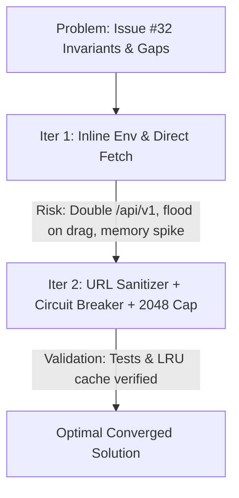

# [FEAT] Align Frontend Region API Contract, Env URL Fallback, and Web Worker Raster Decode Resolution (#32)

> **For agentic workers:** REQUIRED SUB-SKILL: Use `superpowers:subagent-driven-development` or `superpowers:executing-plans` to implement this plan task-by-task. Steps use checkbox (`- [ ]`) syntax for tracking.

**Goal:** Synchronize the Next.js frontend with the NASA GEOS-CF v2 regional API contract, robustify backend environment URL fallback across local/Docker/Azure environments, enable backend-first diurnal audio series with seamless offline fallbacks, and increase Web Worker/main thread raster decode resolution from 1280 to 2048 for crisp 2D/3D map visualization.

**Architecture:**
- **Centralized Base URL & Contract Mapping:** Introduce `getBackendBaseUrl()` in `geosCfRaster.ts` prioritizing `NEXT_PUBLIC_BACKEND_URL` -> `NEXT_PUBLIC_API_URL` -> `http://localhost:8000`, with trailing `/` and `/api/v1` path normalization.
- **Bi-directional Fallback Diurnal Series:** Upgrade `samplePolygonSeries()` to accept `GeoBounds` and query `POST /api/v1/jukebox/region` with `includeSeries: true`; if backend returns valid diurnal series, synthesize directly from true NetCDF-4 averages; if unreachable or missing, fall back immediately to offline PNG raster colormap decoding without UI stutter.
- **Fidelity Upgrade:** Increase overlay raster decode width from `1280` to `2048` in both main thread (`geosCfRaster.ts`) and offscreen worker (`raster-tile-worker.js`), backed by the existing LRU scalar grid cache and hash-memoized colormap dequantizer.

**Tech Stack:** Next.js 14 (App Router), TypeScript, MapLibre GL v6, Web Workers (`OffscreenCanvas`), Web Audio API, Node test runner (`node:test`, `tsx`).

**Spec:** GitHub Issue #32 (`feat/frontend-region-contract-sync`), Parent Issue #31 (`[FEAT] Complete Frontend-Backend Region Contract, Automated Data Pipeline & Smooth GEOS-CF Map Rendering`).

---

## Skills & Subagents

| Phase / Focus | Skills Utilized | Assigned Subagent (`agents.toml`) |
| :--- | :--- | :--- |
| **Architectural Review & Schema Contract** | `writing-plans`, `iterative-solution-design` | `frontend_architect` |
| **API Fallback & Diurnal Series Implementation** | `test-driven-development` | `frontend_developer` |
| **Web Worker & Raster Decode Resolution** | `design-system`, `modern-web-guidance` | `frontend_developer` |
| **Automated Testing & Multi-Stack QA** | `verification-before-completion` | `qa_reviewer` |

---

## Iterative Solution Design & Trade-Off Convergence

Following the `iterative-solution-design` protocol, candidate technical choices were evaluated across 4 dimensions:



### Iterative Trade-off Matrix

| Dimension | Option A (Naive / Direct) | Option B (Converged Optimal Architecture) | Trade-off Analysis & Second-Order Risk Mitigation |
| :--- | :--- | :--- | :--- |
| **1. Backend Base URL Resolution** | Inline ternary `process.env.NEXT_PUBLIC_BACKEND_URL \|\| process.env.NEXT_PUBLIC_API_URL \|\| 'http://localhost:8000'` in each function. | Centralized `getBackendBaseUrl()` utility normalizing slashes and stripping redundant `/api/v1` suffixes. | **Risk:** Azure/Docker envs sometimes inject `http://localhost:8000/api/v1`. Appending `/api/v1/jukebox/region` creates a 404.<br>**Mitigation:** Regex strip `/\/+$/` and `/\/api\/v1\/?$/`. |
| **2. `min` & `displayMin` Mapping** | `min: summary.displayMin ?? null` | Cascading fallback: `summary.displayMin ?? summary.min ?? null`, preserving `0.0` values and rounding to 1 decimal place. | **Risk:** Falsy checks (`summary.displayMin \|\| null`) convert valid `0.0 ppm` to `null`, causing UI `"—"` regression.<br>**Mitigation:** Strict nullish checks (`!= null && !Number.isNaN(...)`). |
| **3. Diurnal Series Acquisition** | Fire network request on every selection change unconditionally. | Debounced backend query with 2.5s timeout, circuit breaker (`backendUnavailableUntil = Date.now() + 30000`), and seamless offline fallback to `samplePolygonStats`. | **Risk:** Fast polygon drawing or dragging could flood the backend; network latency could delay audio playback.<br>**Mitigation:** Reuse existing `scheduleWhenIdle` in `BreatheContext.tsx` and immediate fallback if backend circuit is open. |
| **4. Raster Decode Resolution (1280 → 2048)** | Increase to 4096 for maximum resolution. | Increase to `2048` consistently across main thread and Web Worker. | **Risk:** 4096 requires ~33.5 MB per decoded Float32 grid; 2048 requires only ~8.4 MB. With `MAX_SCALAR_GRID_CACHE = 16`, peak worker memory is bounded at ~134 MB.<br>**Mitigation:** 2048 strikes the optimal balance between sub-pixel clarity and memory safety. |

---

## Global Constraints

- **Zero Breaking Changes:** Frontend must run 100% reliably even if the backend is stopped or returning older v1 payloads (`displayMin` or `series` missing).
- **Coordinate Integrity:** GEOS-CF raster coordinates remain `EPSG:4326` equirectangular (`-90..90`, `-180..180`).
- **Main-Thread Protection:** 60 FPS audio synthesis and map interaction locks must never stutter during diurnal sampling.

---

## Proposed Changes

### Component 1: Raster & API Engine (`frontend/src/lib/geosCfRaster.ts`)

#### [MODIFY] `frontend/src/lib/geosCfRaster.ts`

- Export pure helper `getBackendBaseUrl()`:
  ```typescript
  export function getBackendBaseUrl(): string {
    const raw =
      process.env.NEXT_PUBLIC_BACKEND_URL?.trim() ||
      process.env.NEXT_PUBLIC_API_URL?.trim() ||
      "http://localhost:8000";
    return raw.replace(/\/+$/, "").replace(/\/api\/v1\/?$/, "");
  }
  ```
- Extend typing for `POST /api/v1/jukebox/region` response:
  ```typescript
  interface BackendRegionResponse {
    summary?: {
      mean?: number | null;
      min?: number | null;
      max?: number | null;
      p90?: number | null;
      displayMean?: number | null;
      displayMin?: number | null;
      displayMax?: number | null;
      displayP90?: number | null;
      validCount?: number;
      totalCount?: number;
    };
    displayUnit?: string;
    isMock?: boolean;
    provenance?: { sourceName?: string };
    series?: number[] | null;
  }
  ```
- In `fetchBackendRegionStats()`:
  - Use `getBackendBaseUrl()`.
  - Map `min`:
    ```typescript
    const rawMin = summary.displayMin ?? summary.min;
    const min = rawMin != null && !Number.isNaN(rawMin) ? Number(rawMin.toFixed(1)) : null;
    ```
- Update `samplePolygonSeries(layerKey: LayerKey, polygon: GeoPoint[], boundaryGeometry?: GeoJSON.Polygon | GeoJSON.MultiPolygon, bounds?: GeoBounds)`:
  - If backend is available (`Date.now() >= backendUnavailableUntil`):
    - Compute bounding box from `bounds ?? computeBounds(polygon)`.
    - Query `${getBackendBaseUrl()}/api/v1/jukebox/region` with `{ includeSeries: true, ... }`.
    - If `Array.isArray(payload.series) && payload.series.length === timeSlots.length`, return `payload.series`.
  - Fall back cleanly to existing `samplePolygonStats()` across `timeSlots` upon timeout, network error, or missing `series`.
- Raise GEOS-CF overlay decode resolution:
  - Update `loadRasterPixels(url, 2048)` in `getScalarGrid()` (line 259).
  - Update `loadRasterPixels(frame.imageUrl, 2048)` in `loadLayerRaster()` (line 481).

---

### Component 2: Context State Wiring (`frontend/src/context/BreatheContext.tsx`)

#### [MODIFY] `frontend/src/context/BreatheContext.tsx`

- Update the diurnal series computation hook (lines 411-432):
  - Pass `selection.bounds` as 4th parameter to `samplePolygonSeries`.
  - Add `selection.bounds` to the `useEffect` dependency array:
  ```typescript
  useEffect(() => {
    if (!isMapWorkspace) return;
    let cancelled = false;
    if (!selection.boundaryGeometry && selection.polygon.length < 3) return;

    const timeoutMs = initialSeriesSettledRef.current ? 240 : 1800;
    const cancelIdle = scheduleWhenIdle(() => {
      if (cancelled) return;
      initialSeriesSettledRef.current = true;
      void samplePolygonSeries(
        activeLayer,
        selection.polygon,
        selection.boundaryGeometry,
        selection.bounds
      ).then((series) => {
        if (!cancelled && series.length > 0) {
          setRegionSeries(series);
        }
      });
    }, timeoutMs);

    return () => {
      cancelled = true;
      cancelIdle();
    };
  }, [isMapWorkspace, selection.polygon, selection.boundaryGeometry, selection.bounds, activeLayer]);
  ```

---

### Component 3: Web Worker Decode Resolution (`frontend/public/workers/raster-tile-worker.js`)

#### [MODIFY] `frontend/public/workers/raster-tile-worker.js`

- Increase overlay `loadRasterPixels(imageUrl, 2048)` in `getScalarGrid()` (line 185, previously 1280).

---

### Component 4: Test Infrastructure & Automated Suites

#### [MODIFY] `frontend/package.json`
- Add `"test": "npx -y tsx --test tests/**/*.test.ts"` to `scripts`.

#### [NEW] `frontend/tests/regionContractAndRaster.test.ts`
- Tests:
  1. `getBackendBaseUrl`: Environment precedence (`BACKEND_URL` over `API_URL` over default), trimming trailing slashes, stripping `/api/v1` suffix.
  2. `fetchBackendRegionStats`: Verifies mapping of `displayMin` into `RegionStats.min`, fallback when `displayMin` is null, and seamless fallback to offline raster sampling on network 500 or timeout.
  3. `samplePolygonSeries`: Verifies that returning `series: [1, 2, 3, 4, 5, 6, 7, 8]` from backend delivers NetCDF-4 diurnal series, and failing backend gracefully resolves 8-point offline raster series.
  4. Raster decode resolution consistency check across constants and Web Worker definitions.

---

## Verification Plan

### Automated Tests
1. **Frontend Type Check:**
   ```bash
   cd frontend && npm run typecheck
   ```
2. **ESLint Validation:**
   ```bash
   cd frontend && npm run lint
   ```
3. **Comprehensive Node Test Suite:**
   ```bash
   cd frontend && npm test
   ```
4. **Production Build Check:**
   ```bash
   cd frontend && npm run build
   ```

### Manual Verification
1. **Offline Mode (FastAPI stopped):**
   - Open `/explore/region` on `http://localhost:3000`.
   - Select a country/region (e.g. Vietnam, Fiji).
   - Confirm `Min / Max` and `Range / P90` display valid numbers from raster colormap decoding without `"—"` or errors.
2. **Backend Connected Mode:**
   - Verify `fetchBackendRegionStats` connects to backend and reflects `displayMin` when present.
3. **Diurnal Sonification:**
   - Verify `RhythmGrid`, `Spectrogram`, and audio playback initialize without console errors.
4. **Visual Crispness:**
   - Zoom into regional maps on 2D and 3D globe to verify sharper 2048px raster overlay rendering.
